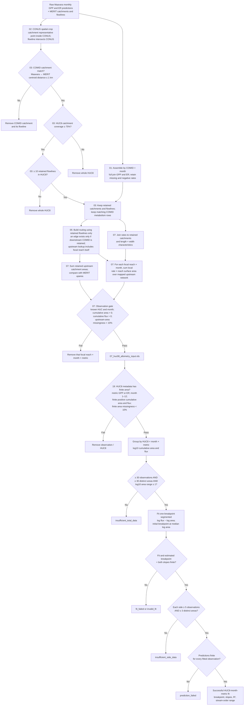

# Current HUC8 segmented analysis: data and filtering flowchart

**Scope.** This traces the current full-reach, monthly HUC8 segmented results in `data/processed/19_monthly_huc8_segmented_full_reaches.csv`. A "reach" at the final stage means one focal reach × month × metabolism observation. GPP and ER are screened independently. A HUC8 is represented if **at least one** month–metabolism fit succeeds; it need not pass for all 24 combinations.

## Gate inventory and interpretation

| Stage | Unit affected | Enforced rule | Consequence / source |
|---|---|---|---|
| Assemble monthly rates | COMID × month | 12 GPP and 12 ER monthly files must be present. Rates are full-joined by COMID × month. | Missing and **negative** rates remain in the assembled table. `scripts/01_assemble_metabolism.R`. |
| CONUS crop | Spatial reach/catchment | Catchment representative point lies in lower-48 CONUS; flowline intersects it. | Outside features removed. `scripts/02_crop_merit_to_conus.R`. |
| Catchment identity | COMID and flowline | Matched Maavara/MERIT catchment centroids ≤ 1 km apart. Flowline COMID must match retained catchment COMID. | Mismatched COMIDs removed. `scripts/03_filter_HUC8s.Rmd`. |
| HUC8 spatial coverage | Entire HUC8 | Retained catchments cover ≥ 75% of HUC8 polygon area. | Below-threshold HUC8s removed with their reaches. `scripts/03_filter_HUC8s.Rmd`. |
| HUC8 raw network size | Entire HUC8 | ≥ 10 retained MERIT flowlines. | HUC8s with < 10 removed. This is an early spatial gate, not the segmented-fit minimum. `scripts/03_filter_HUC8s.Rmd`. |
| Routing | Upstream contributions | Downstream link retained only when its target COMID is in the retained network. Each focal reach is in its own upstream set. | Clipping can create artificial terminals. No minimum upstream-network size is imposed. `scripts/05_build_routing_network.R`. |
| Local flux and accumulation | Reach × month × metric | Local flux = modeled rate × length × 1,000 × width; cumulative flux sums nonmissing local fluxes over mapped upstream reaches. | Missing local flux is omitted; negative local flux is **included with its sign**. Missingness percentages are calculated. `scripts/07_calculate_huc8_allometric_scaling.Rmd`. |
| Cumulative observation | Focal reach × month × metric | HUC and month present; cumulative area > 0; cumulative flux > 0; `pct_area_missing < 10`. | Failed observations absent from `07_huc08_allometry_input.rds`. A missing local rate does not automatically remove a focal downstream observation. `scripts/07_calculate_huc8_allometric_scaling.Rmd`. |
| HUC8 metadata / repeat validation | Observation / HUC8 | HUC8 has finite `huc8_area_km2`; month 1–12; GPP or ER; finite positive cumulative area/flux; finite `pct_area_missing < 10`. | Full-reach segmented input. Stream order is joined for reporting; a missing stream order does not exclude the fit. `scripts/x_19_monthly_huc8_segmented_full_reaches.R`. |
| Group size and extent | HUC8 × month × metric | ≥ 30 observations, ≥ 30 distinct cumulative areas, ≥ 1 log10 unit of area span (factor of 10). | Otherwise `insufficient_total_data`. `scripts/x_19_monthly_huc8_segmented_full_reaches.R`. |
| Fit validity | HUC8 × month × metric | One-breakpoint `segmented(lm(...))` converges and yields finite breakpoint and slopes. | Otherwise `fit_failed` or `invalid_fit`. Same script. |
| Breakpoint-side support | HUC8 × month × metric | ≥ 5 observations and ≥ 3 distinct areas on **each** side of fitted breakpoint. | Otherwise `insufficient_side_data`. Same script. |
| Prediction validity | HUC8 × month × metric | Finite predictions for all included observations. | Otherwise `prediction_failed`; otherwise `status = ok`. Same script. |

## What is *not* a current segmented-fit gate

- `missing_metabolism_threshold <- 10` is declared in script 07, and GPP/ER metabolism missingness is calculated, but **neither script 07 nor script 19 filters by it**. Thus an upstream network with substantial missing local metabolism can still yield a fit.
- Local GPP/ER rates are **not** required to be nonnegative. Negative rates enter cumulative sums; only the final cumulative flux must be positive.
- The HUC8 summary's positive-rate month counts, `n_complete_flowlines`, headwater agreement, and ecoregion are descriptive. No minimum complete-month count, headwater requirement, or ecoregion completeness test appears in script 19. It does require a finite HUC8 area from that summary.
- The script 07 **single-line** HUC8 analysis uses ≥ 20 reaches, ≥ 20 distinct areas, a factor-of-10 area span, and labels R² < 0.8 as `low_r2`. Those rules belong to `07_huc08_allometry_results.csv`, not the current segmented fits.
- The R² ≥ 0.5 threshold in `scripts/x_23_full_huc8_slope_boxplot_r2_05.R` selects fits **for that plot only**. It does not change `status` or the 1,807 HUC8s with successful segmented fits. The unfiltered boxplot in script `x_20` requires `status = ok` plus a nonmissing dominant ecoregion for display.
- Earlier diagnostic choices to exclude large HUC8-area outliers, cap input at 20,000 reaches, or require a minimum upstream reach count are **not** gates in the current full-reach segmented script.

## Current output counts

The saved HUC8 summary contains **1,894** HUC8s with finite HUC8 area. The saved segmented result has **41,439 successful HUC8 × month × metric fits** across **1,807 distinct HUC8s**. Another 2,169 group results have `insufficient_total_data`, and 1,848 have `insufficient_side_data`. These counts describe the saved current files; they are not additional thresholds.

**Open decision:** The proposed change to treat negative local GPP/ER rates as `NA` or zero is **not implemented** in the current pipeline. Either policy would require rebuilding cumulative fluxes and re-evaluating these gates; the chart above documents the existing behavior.
