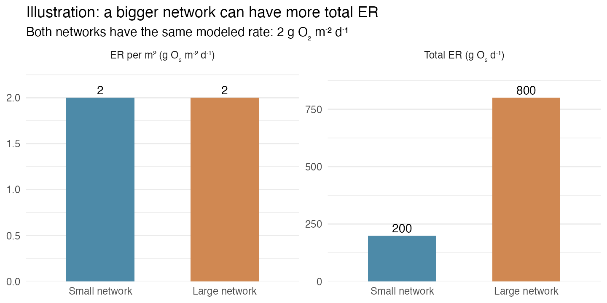
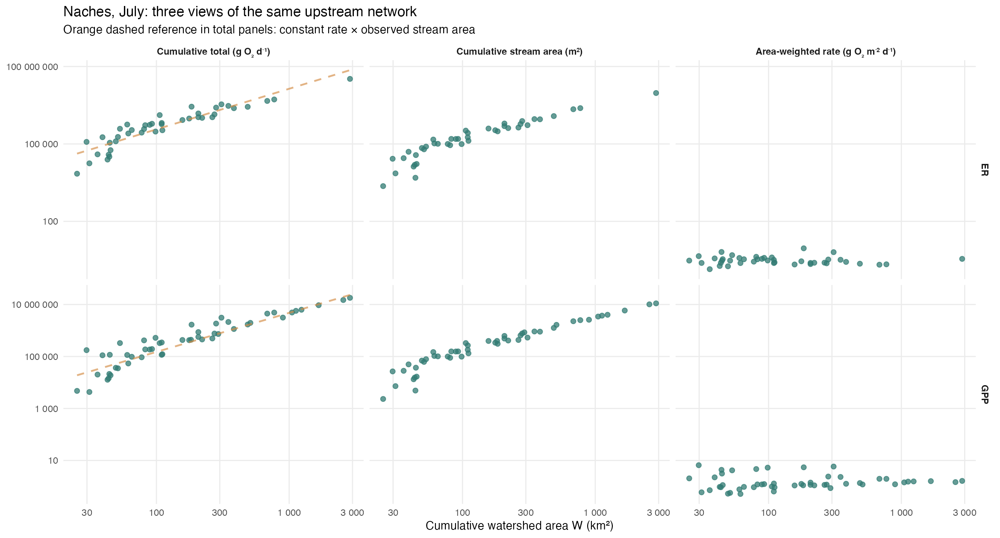
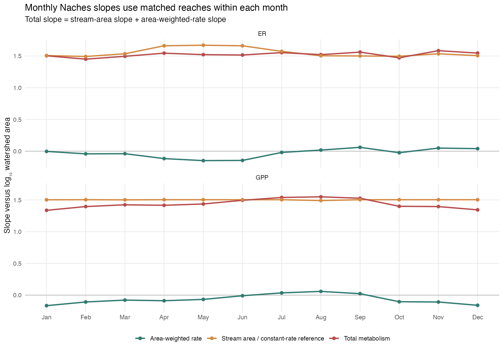

# What Bob's note means for our allometry analysis

**Test case:** Naches HUC8 (17030002). This is a short check of what our present calculation measures. The figures are generated by [`x_261015_naches_bob_allometry_walkthrough.R`](../scripts/x_261015_naches_bob_allometry_walkthrough.R); they do not change the production workflow.

## 1. Why Bob is concerned

Bob's basic point is that **more stream surface can produce more total metabolism even when metabolism per square meter stays the same**. For example, at a constant ER rate of 2 g O₂ m⁻² d⁻¹, 100 m² of stream produces 200 g O₂ d⁻¹ and 400 m² produces 800 g O₂ d⁻¹.

*Illustration only; these are not Naches observations.* In symbols, total ER is `R = r × S`, where `r` is ER per m² and `S` is stream surface area. A rising total therefore does **not** by itself show that ER per m² rises. Total metabolism versus network size remains a valid question; it answers a different question.

## 2. What our code actually does

[`01_assemble_metabolism.R`](../scripts/01_assemble_metabolism.R) saves Maavara monthly GPP and ER estimates in **g O₂ m⁻² d⁻¹**. In the current working copy of [`07_calculate_huc8_allometric_scaling.Rmd`](../scripts/07_calculate_huc8_allometric_scaling.Rmd), negative local rates become missing. Each remaining local rate is multiplied by its reach's stream surface area, `lengthkm × 1,000 × merit_width`, to obtain **g O₂ d⁻¹**. The full [`05_build_routing_network.R`](../scripts/05_build_routing_network.R) lookup includes the focal reach itself; script 07 sums nonmissing local fluxes over that reach and all retained upstream reaches.

| Quantity | Meaning | Units | Spatial extent |
|---|---|---|---|
| `rᵢ` | Modeled local GPP or ER rate | g O₂ m⁻² d⁻¹ | Reach `i` |
| `Sᵢ` | `lengthkm × 1,000 × merit_width` | m² | Reach `i` |
| `R_up` | Sum of `rᵢ × Sᵢ` | g O₂ d⁻¹ | Focal reach plus retained upstream network |
| `S_up` | Sum of `Sᵢ` for reaches with valid rates | m² | Same contributing reaches as `R_up` |
| `r̄_up` | `R_up / S_up`, an area-weighted rate | g O₂ m⁻² d⁻¹ | Same contributing reaches |
| `W` | Sum of incremental `unitarea` catchments | km² | Focal reach plus retained upstream network |

**The current fitted response is `R_up`, not `r̄_up`.** Script 07 fits `log10(cumulative_flux_g_o2_d) ~ log10(cumulative_area_km2)` separately for each HUC8, month, and metabolism metric. It does **not** divide the upstream total by stream area after accumulation. Summing local rates, or dividing by only the focal reach's stream area, would define different responses; neither is done here.

`W` is built by adding each routed reach's *incremental catchment* `unitarea` once, rather than adding overlapping nested `uparea` values. Rebuilding Naches `W` from the routing lookup agrees with the saved fit input. The lookup is built across the retained national network, so a focal HUC8 reach **can** have upstream contributors outside its HUC8. None of the upstream source reaches used for these Naches fit points is outside Naches. HUC8 membership selects focal observations; routing defines their contributing area.

Each dot in a monthly fit is one focal reach's cumulative total and cumulative watershed area. Script 07 keeps positive cumulative flux and area, less than 10% missing upstream watershed area, and less than 10% missing metabolism coverage. It then requires at least 20 reaches, 20 distinct areas, and one decade of area range for a monthly fit.

## 3. The issue in Naches

July was fixed as the example month before comparing slopes. The first column below is **our actual current response**; it is also the upstream total, so a duplicate panel is unnecessary. The middle column shows the matching upstream stream surface. The last column divides the total by that surface. The dashed line is a simple constant-rate comparison: every contributing reach is assigned the same positive rate (the July median area-weighted rate), using the observed Naches stream geometry and the same eligible focal reaches. It is an explanatory reference, not an inferential null test.

The July ordinary log–log slopes, fitted to identical reaches within each metric, are:

| July | Reaches | Total `R_up` vs `W` | Stream area `S_up` vs `W` | Rate `r̄_up` vs `W` |
|---|---:|---:|---:|---:|
| ER | 42 | 1.553 | 1.573 | −0.020 |
| GPP | 51 | 1.539 | 1.504 | +0.035 |

For both metrics, most of the July total-flux slope follows how stream surface area grows with watershed area. The July area-weighted-rate slopes are close to zero; this is a descriptive observation, not proof that the rates are constant.

The broader check does not silently pool months. Across the 12 separately fitted months, the area-weighted-rate slope ranges from **−0.149 to +0.061 for ER** and **−0.166 to +0.059 for GPP**. Its sign changes, while the stream-area slope remains near 1.5–1.67 for ER and 1.49–1.50 for GPP. Monthly sample sizes vary with the current coverage filters; [the exact slopes and counts](naches_bob_allometry/monthly_slopes.csv) are available beside the figures.

## 4. Assessment

Bob's algebra is right **when stream surface area is the horizontal axis**: if `r` is constant, `log(R)` versus `log(S)` has slope 1. Our horizontal axis is instead **upstream watershed area `W`**. Under a constant rate, the expected total-flux slope against `W` is the observed slope of `S_up` against `W`—about 1.5 in Naches—not necessarily 1. The constant-rate expectation for `r̄_up` versus `W` is slope 0.

The identity `R_up = r̄_up × S_up` means the three ordinary log–log slopes add exactly when fitted to the same points: **total slope = stream-area slope + area-weighted-rate slope**. The script checks this numerically for every month. This identity would not justify subtracting slopes from different observations or separately chosen segmented breakpoints.

**Verdict:** Bob's concern applies to our implemented response because it is an upstream **total**, despite our earlier description of it as normalized. Naches total metabolism increases strongly with watershed area, but these plots give little evidence of a consistent increase in metabolism **per m²**. Using slope 1 as the general constant-rate reference for total flux versus watershed area is not appropriate here. The smallest companion analysis is to show `S_up` and `r̄_up` against `W` alongside the existing total-flux fit, using matched reaches within each month.

These are descriptive relationships among overlapping upstream networks built from modeled Maavara rates. Shared reaches and model-derived inputs limit independence and causal interpretation; neither a total-flux slope nor an area-weighted-rate slope alone identifies a biological mechanism.
