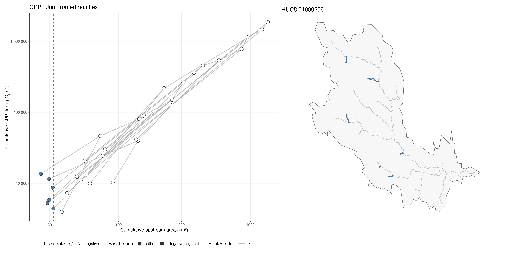
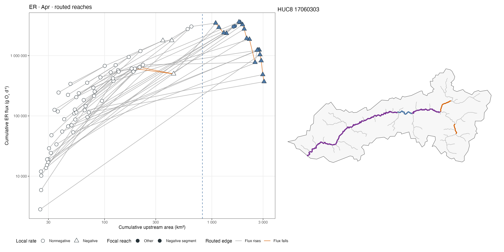

# Audit of two negative HUC8 metabolism slopes

This report traces two successful segmented fits in `19_monthly_huc8_segmented_full_reaches.csv` back to the source monthly rates, reach surface areas, routing lookup, and saved cumulative fluxes. Reproduce it with `Rscript scripts/x_25_audit_negative_huc8_slopes.R`. The script writes the figures, focal-reach and routed-edge tables, and `reports/negative_slope_audit/case_summary.csv`.

## Why a negative fitted slope does not automatically violate accumulation

Script 07 calculates local flux as `rate (g O2 m-2 d-1) × length (km) × 1,000 × width (m)` and cumulative flux as the sum of available local fluxes over each focal reach's mapped upstream set, including itself. For a *nested pair of reaches* A → B, `F(B) - F(A)` equals the sum of the local fluxes added between them. It must be nonnegative **only if every added local flux is nonnegative**. A regression within a HUC8 also compares reaches on different branches, which need not be nested; monotonicity along a routed path does not constrain the slope across those independent observations.

The source table `01_assembled_maavara_monthly_metabolism.rds` includes negative modeled rates: 3,300 of 2,101,392 GPP reach-months (0.157%) and 71,968 of 2,101,392 ER reach-months (3.425%). Script 07 carries those signed values into the routing sum. It filters **cumulative** flux to positive values afterward; it does not require local rates to be nonnegative. This is the first point where the assumption that only positive quantities accumulate diverges from the implemented calculation.

## Case 1: GPP, January, HUC8 01080206

- The fit has 33 focal reaches, a 32.07 km² breakpoint, and a smaller-area slope of **−3.5423**. Its smaller segment contains only **six** reaches.
- All six are mapped one-reach headwaters. Their cumulative areas are 25.66–31.95 km²; cumulative fluxes are 4,418–13,570 g O2 d-1. Each cumulative value equals its own local flux, calculated from its rate, length, and width. Rates are all positive.
- The six headwaters occupy separate branches. There are **zero direct routing edges within the negative segment**. All 32 checked direct edges among the 33 fitted reaches increase in both cumulative area and cumulative GPP flux.
- Recalculation from the original local fluxes and upstream lookup matches the saved cumulative values within 7.0×10⁻¹⁰ g O2 d-1. Area and metabolism missingness in this fitted group are effectively zero.

**Diagnosis:** This is a cross-branch regression artifact, not a downstream loss of accumulated GPP. The negative slope summarizes six independent, heterogeneous headwaters in a narrow area interval. Allowing five reaches on a segment made this fit eligible, but the sign should not be interpreted as a downstream process.

## Case 2: ER, April, HUC8 17060303

- The fit has 79 focal reaches, an 816.45 km² breakpoint, and a larger-area slope of **−1.6912**. Its larger segment contains **20** reaches, 18 of which have negative local ER rates.
- Of 78 direct routed edges in the fitted HUC8, cumulative ER flux falls on **15** while cumulative area rises. Within the larger-area segment, flux falls on **13 of 19** direct edges. For example, the focal series falls from 823,535 g O2 d-1 at 2,882.9 km² to 484,898 at 2,981.6 km² and 370,004 at 3,066.1 km².
- Recalculation from the source rate × reach surface area and exact upstream membership matches saved cumulative ER flux within 1.2×10⁻⁹ g O2 d-1. Area and metabolism missingness are effectively zero.
- As a **diagnostic counterfactual only**, replacing negative local ER fluxes with zero *before routing* eliminates all 15 declining edges. Refitting that altered series yields positive slopes (7.478 and 1.038) and a different breakpoint (37.17 km²). This is not a recommended correction until the meaning and validity of negative ER model outputs are resolved.

**Diagnosis:** The downstream decline is genuine in the stored arithmetic, because negative modeled ER values enter the upstream sum. It is not evidence of a broken routing sum. Whether a signed negative ER contribution is scientifically valid for the quantity being called cumulative ER flux is a source-data and estimand question.

## Implications and next checks

1. **Resolve the sign convention and prediction validity.** Inspect raw Maavara model outputs and documentation for negative ER and GPP estimates. If these are rates intended as nonnegative production/respiration magnitudes, the current signed summation is incompatible with that estimand. Do not take absolute values or truncate them without a documented rule and sensitivity analysis.
2. **Separate along-network monotonicity from pooled HUC8 scaling.** A negative slope across separate branches is mathematically possible even with all-positive local fluxes. For a claim about downstream accumulation, test routed upstream–downstream pairs or paths, rather than a cross-branch segmented regression alone.
3. **Flag weak segment support.** The GPP example uses six independent headwaters below its breakpoint. Report side-specific counts, area range, and routing connectivity alongside slopes; an overall R² filter does not address this failure mode.
4. **Add routine QC.** For each month and metabolism, tally negative local predictions and directly connected edges with decreasing cumulative flux. Preserve both the original signed result and any explicitly defined nonnegative-flux sensitivity run.

These two cases expose distinct analytical risks; they do not establish the frequency or ecological cause of every negative fit in the CONUS analysis.
