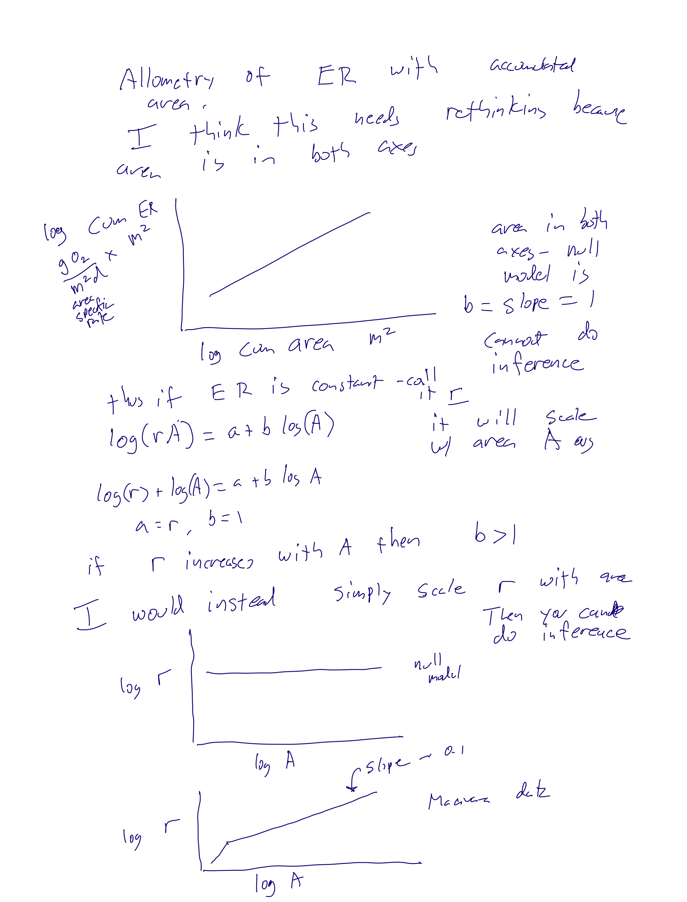

```{=html}
<style>
h1, h2 {
  border-bottom: 2px solid #999;
  padding-bottom: 8px;
  margin-top: 30px;
}
</style>
```

```{r setup, include=FALSE}
knitr::opts_chunk$set(echo = FALSE, warning = FALSE, message = FALSE,
                      fig.align = "center")
library(sf)
library(dplyr)
library(tidyr)
library(ggplot2)
library(cowplot)
library(patchwork)
library(scales)
library(rnaturalearth)

theme_set(theme_bw())

# Knit from the project root or from RStudio with this file open.
project_dir <- if (file.exists("metabolism_allometry.Rproj")) "." else ".."
data_path <- function(...) file.path(project_dir, "data", "processed", ...)
target_huc8 <- "17030002"
target_huc4 <- substr(target_huc8, 1, 4)
map_crs <- 5070 # CONUS Albers equal-area; shared across the three panels.
```

## Naches HUC8 as a test watershed

Naches (HUC8 `r target_huc8`) is a familiar watershed with all GPP and most ER data intact, and it's headwaters (not inheriting upstream inputs) so it will be our guinea pig:

```{r load-map-data}
wbd <- st_read(data_path("04c_huc08_boundaries.gpkg"), quiet = TRUE) |>
  mutate(huc8 = as.character(huc8)) |>
  st_transform(map_crs)
stopifnot(sum(wbd$huc8 == target_huc8) == 1L)
naches <- wbd |> filter(huc8 == target_huc8)
huc4_parts <- wbd |> filter(substr(huc8, 1, 4) == target_huc4)
stopifnot(nrow(huc4_parts) > 0L)
huc4 <- huc4_parts |> summarise()

conus <- ne_states(country = "United States of America", returnclass = "sf") |>
  filter(!postal %in% c("AK", "HI", "PR")) |>
  st_transform(map_crs)

merit_dir <- data_path("merit_data")
catchments <- st_read(file.path(merit_dir,
  "03_cat_pfaf_7_MERIT_Hydro_v07_Basins_v01_CONUS_filtered.shp"),
  quiet = TRUE) |>
  filter(huc == target_huc8) |>
  mutate(comid = as.character(comid)) |>
  select(comid, unitarea) |>
  st_transform(map_crs)
flowlines <- st_read(file.path(merit_dir,
  "03_riv_pfaf_7_MERIT_Hydro_v07_Basins_v01_CONUS_filtered.shp"),
  quiet = TRUE) |>
  filter(huc == target_huc8) |>
  mutate(comid = as.character(comid)) |>
  select(comid, uparea) |>
  st_transform(map_crs)
stopifnot(nrow(catchments) > 0L, nrow(flowlines) > 0L,
          !anyDuplicated(catchments$comid), !anyDuplicated(flowlines$comid))

metabolism <- readRDS(data_path("01_assembled_maavara_monthly_metabolism.rds")) |>
  as_tibble() |>
  transmute(comid = as.character(comid), month,
            gpp = as.numeric(gpp_gO2_m2_d),
            er = as.numeric(er_gO2_m2_d)) |>
  filter(comid %in% flowlines$comid) |>
  mutate(across(c(gpp, er), ~ if_else(is.finite(.x) & .x >= 0, .x, NA_real_)))
rates_by_reach <- metabolism |>
  group_by(comid) |>
  summarise(median_gpp = if (all(is.na(gpp))) NA_real_ else median(gpp, na.rm = TRUE),
            median_er = if (all(is.na(er))) NA_real_ else median(er, na.rm = TRUE),
            valid_gpp_months = sum(!is.na(gpp)),
            valid_er_months = sum(!is.na(er)), .groups = "drop")
catchments <- left_join(catchments, rates_by_reach, by = "comid")
flowlines <- left_join(flowlines, rates_by_reach, by = "comid")
stopifnot(nrow(catchments) == nrow(flowlines),
          setequal(catchments$comid, flowlines$comid),
          any(is.finite(flowlines$median_gpp)))
```

```{r watershed-map, echo=FALSE, fig.width=15, fig.height=7.5, dpi=220}
ink <- "#19354A"
land <- "#ECF0EC"
accent <- "#D5653C"
map_theme <- theme_void(base_size = 12) +
  theme(plot.background = element_rect(fill = "white", colour = NA),
        panel.background = element_rect(fill = "white", colour = NA),
        plot.margin = margin(8, 8, 8, 8))

p_conus <- ggplot() +
  geom_sf(data = conus, fill = land, colour = "white", linewidth = 0.18) +
  geom_sf(data = huc4, fill = accent, colour = "#8F3D2A", linewidth = 0.5) +
  geom_sf(data = conus, fill = NA, colour = "#A2B0AE", linewidth = 0.23) +
  coord_sf(crs = st_crs(map_crs), datum = NA, expand = FALSE) +
  map_theme

p_huc4 <- ggplot() +
  geom_sf(data = huc4_parts, fill = "#E3EAE7", colour = "white", linewidth = 0.7) +
  geom_sf(data = naches, fill = accent, colour = "#8F3D2A", linewidth = 0.65) +
  geom_sf(data = huc4, fill = NA, colour = ink, linewidth = 0.85) +
  coord_sf(crs = st_crs(map_crs), datum = NA, expand = FALSE) +
  map_theme

gpp_limits <- range(c(catchments$median_gpp, flowlines$median_gpp), na.rm = TRUE)
gpp_palette <- scale_fill_viridis_c(option = "mako", direction = -1,
  limits = gpp_limits, na.value = "#D1D5D3",
  name = "Median local GPP\n(g O2/m2/day)")
p_naches <- ggplot() +
  geom_sf(data = catchments, aes(fill = median_gpp),
          colour = "#687B79", linewidth = 0.24) +
  geom_sf(data = flowlines, colour = "#FFFFFF", linewidth = 2.4,
          lineend = "round") +
  geom_sf(data = flowlines, aes(colour = median_gpp), linewidth = 1.45,
          lineend = "round") +
  geom_sf(data = naches, fill = NA, colour = ink, linewidth = 0.8) +
  gpp_palette +
  scale_colour_viridis_c(option = "mako", direction = -1,
    limits = gpp_limits, na.value = "#87918F", guide = "none") +
  coord_sf(crs = st_crs(map_crs), datum = NA, expand = FALSE) +
  map_theme +
  theme(legend.position = "bottom",
        legend.title = element_text(size = 10, colour = ink),
        legend.text = element_text(size = 9),
        legend.key.width = grid::unit(2.3, "cm"))

(p_conus | p_huc4 | p_naches) +
  plot_layout(widths = c(1.05, 0.85, 1.25))
```

## Data distributions

First, a peek at the datasets we're using for context. Note that Maavara et al. (2025) filtered out watersheds draining less than 25 km² for total drainage area upstream of a channel in the MERIT network (`uparea`), and we're plotting the land area added locally at each reach (`unitarea`). For Naches, `unitarea` (`r sum(catchments$unitarea < 25)` of `r nrow(catchments)` are below 25 km²; `uparea` minimum here: `r round(min(flowlines$uparea), 2)` km²).

```{r local-area-vs-rates, fig.width=11, fig.height=5.2, dpi=220}

plot_distribution <- function(var){
  ggplot(catchments |> st_drop_geometry(), 
       aes(x = 1, y = {{var}})) + 
    geom_violin(fill = "blue", alpha = 0.2) + 
    geom_jitter(color = "gray10", width = 0.1) +
    theme_bw()
}

plot_grid(plot_distribution(unitarea), 
          plot_distribution(median_gpp), 
          plot_distribution(median_er), 
          nrow = 1)

```

## Our current approach:

1.  Process rate, either GPP or ER (`r`, g O2 / m2 / day), is normalized to stream surface area (`S`, m\^2) to give us reach-integrated process rates (`R`, g O2 / day\`)
2.  Reach-integrated process rates (`R`) are accumulated downstream, as are contributing watershed areas (`A`). Note that all upstream rates/areas AND the reach rate/area are included here.
3.  We regress `R` against `A` in log-log space and fit slopes for allometric scaling

You could write step 2 as $$
R=\sum_{i\in U}r_iS_i,\qquad A=\sum_{i\in U}A_i.
$$ \n Which gives us this relationship (based on Wollheim et al. 2022 and Regier et al. 2025 normalization approaches):

```{r naches-july-fit-input, include=T}
# Script 07 has already accumulated local flux and catchment area upstream.
naches_july_allometry <- readRDS(data_path("07_huc08_allometry_input.rds")) |>
  as_tibble() |>
  filter(huc == target_huc8, month == 7L,
         metabolism_metric %in% c("GPP", "ER")) |>
  transmute(comid = as.character(downstream_comid),
            process = factor(metabolism_metric, levels = c("GPP", "ER")),
            upstream_watershed_km2 = cumulative_area_km2,
            upstream_total_g_o2_d = cumulative_flux_g_o2_d)
stopifnot(nrow(naches_july_allometry) > 0L,
          all(naches_july_allometry$upstream_watershed_km2 > 0),
          all(naches_july_allometry$upstream_total_g_o2_d > 0),
          all(table(naches_july_allometry$process) >= 20L))

ggplot(naches_july_allometry, aes(log10(upstream_watershed_km2), 
                                  log10(upstream_total_g_o2_d))) + 
  geom_point(alpha = 0.7) + 
  geom_abline(slope = 1, intercept = 0, linetype = "dashed") +
  geom_smooth(se = F, color = "black", method = "lm") +
  facet_wrap(~process, nrow = 1) + 
    labs(x = "log10 cumulative upstream area (m2)",
       y = "log10 cumulative GPP or ER (g O2/day)")
```

### Quick confirmation patterns are as expected...

```{r}
ggplot() + 
  geom_sf(data = naches, fill = NA) + 
  geom_sf(data = flowlines %>% 
  left_join(naches_july_allometry, by = "comid") %>% 
    filter(process == "GPP"), 
  aes(size = upstream_watershed_km2, color = upstream_total_g_o2_d)) + 
  scale_color_viridis_c() + 
  theme_map()
```

## Bob's note:

```{r bobs-note}

```

### Clarification on areas (`A` vs `S`)

As I read it, Bob's note assumes we are normalizing our reach-scale rates (`r`) to watershed area (`A`). **Our calculations are normalizing to stream surface area (`S`), not watershed area (`A`)**. We are still normalizing to *an* area (`S`), **but** not to the same area as is on our x-axis (`A`).

## Walking through Bob's proposal

### Step 1: If we normalized `r` by `A`, what would we have?

Similar to what Bob was suggesting, a slope close to 1

```{r}
# Use the same July focal reaches as the current allometry comparison.
focal_comids <- unique(naches_july_allometry$comid)
upstream_links <- data.table::as.data.table(
  readRDS(file.path(merit_dir, "05_upstream_lookup.rds")))
upstream_links <- upstream_links[
  as.character(downstream_comid) %in% focal_comids,
  .(comid = as.character(downstream_comid),
    source_comid = as.character(upstream_comid))] |>
  as_tibble()

# Replace stream surface S_i with each source reach's incremental
# watershed area a_i, converted from km2 to m2 before multiplying by r_i.
source_inputs <- metabolism |>
  filter(month == 7L) |>
  pivot_longer(c(gpp, er), names_to = "process", values_to = "rate") |>
  mutate(process = factor(toupper(process), levels = c("GPP", "ER"))) |>
  left_join(catchments |>
              st_drop_geometry() |>
              select(comid, unitarea), by = "comid") |>
  transmute(source_comid = comid, process,
            catchment_area_m2 = unitarea * 1e6,
            area_integrated_g_o2_d = rate * catchment_area_m2)
stopifnot(all(unique(upstream_links$source_comid) %in%
                source_inputs$source_comid))

watershed_weighted <- upstream_links |>
  left_join(source_inputs, by = "source_comid",
            relationship = "many-to-many") |>
  group_by(comid, process) |>
  summarise(cumulative_g_o2_d =
              if (all(is.na(area_integrated_g_o2_d))) NA_real_ else
                sum(area_integrated_g_o2_d, na.rm = TRUE),
            .groups = "drop") |>
  right_join(naches_july_allometry |>
               select(comid, process, upstream_watershed_km2),
             by = c("comid", "process")) |>
  mutate(cumulative_area_m2 = upstream_watershed_km2 * 1e6) |>
  filter(is.finite(cumulative_g_o2_d), cumulative_g_o2_d > 0,
         is.finite(cumulative_area_m2), cumulative_area_m2 > 0)
stopifnot(nrow(watershed_weighted) == nrow(naches_july_allometry))

ggplot(watershed_weighted,
       aes(log10(cumulative_area_m2), log10(cumulative_g_o2_d))) +
  geom_abline(intercept = 0, slope = 1,
              linetype = "dashed", colour = "#A35C43") +
  geom_point(alpha = 0.7, colour = "#187A8C") +
  geom_smooth(method = "lm", formula = y ~ x, se = FALSE,
              colour = "#19354A") +
  facet_wrap(~ process, nrow = 1) +
  labs(x = "log10 cumulative upstream area (m2)",
       y = "log10 cumulative GPP or ER (g O2/day)") +
  theme_minimal()
```

### Step 2: What if we just do cumulative rate (`r`) normalized to nothing?

```{r}
# Sum the original July reach rates over each focal reach's upstream network;
# do not multiply or divide by stream surface or watershed area.
source_rates <- metabolism |>
  filter(month == 7L) |>
  pivot_longer(c(gpp, er), names_to = "process", values_to = "rate") |>
  transmute(source_comid = comid,
            process = factor(toupper(process), levels = c("GPP", "ER")),
            rate)

cumulative_unweighted_rates <- upstream_links |>
  left_join(source_rates, by = "source_comid",
            relationship = "many-to-many") |>
  group_by(comid, process) |>
  summarise(cumulative_rate =
              if (all(is.na(rate))) NA_real_ else sum(rate, na.rm = TRUE),
            .groups = "drop") |>
  right_join(naches_july_allometry |>
               select(comid, process, upstream_watershed_km2),
             by = c("comid", "process")) |>
  mutate(cumulative_area_m2 = upstream_watershed_km2 * 1e6) |>
  filter(is.finite(cumulative_rate), cumulative_rate > 0,
         is.finite(cumulative_area_m2), cumulative_area_m2 > 0)
stopifnot(nrow(cumulative_unweighted_rates) == nrow(naches_july_allometry))

ggplot(cumulative_unweighted_rates,
       aes(log10(cumulative_area_m2), log10(cumulative_rate))) +
  geom_abline(slope = 0, intercept = 0,
              linetype = "dashed", colour = "#A35C43") +
  geom_point(alpha = 0.7, colour = "#187A8C") +
  geom_smooth(method = "lm", formula = y ~ x, se = FALSE,
              colour = "#19354A") +
  facet_wrap(~ process, nrow = 1) +
  labs(x = "log10 cumulative upstream area (m2)",
       y = "log10 cumulative GPP or ER rate (g O2/m2/day)") +
  theme_minimal()
```

### Step 3: If we normalize to `S` instead of `A`, what do we get?

We aren't directly comparing `r*A` vs `A`, but we are comparing an areal component (`S`) that correlates to `A`

```{r naches-upstream-watershed-vs-stream-area, fig.width=8, fig.height=6}
# S is the sum of stream surface areas for the focal reach and all upstream reaches.
local_stream_area <- readr::read_csv(
  file.path(project_dir, "data/raw/dryad_data/scaling_dataset_Qmonth_06082024.csv"),
  col_types = readr::cols(COMID = readr::col_character()),
  col_select = c(COMID, lengthkm, merit_width),
  show_col_types = FALSE) |>
  transmute(source_comid = COMID,
            stream_area_m2 = lengthkm * 1000 * merit_width) |>
  filter(source_comid %in% upstream_links$source_comid)

upstream_stream_area <- upstream_links |>
  left_join(local_stream_area, by = "source_comid") |>
  group_by(comid) |>
  summarise(S_m2 = if (any(!is.finite(stream_area_m2))) NA_real_ else
              sum(stream_area_m2), .groups = "drop") |>
  left_join(naches_july_allometry |>
              distinct(comid, upstream_watershed_km2), by = "comid") |>
  mutate(A_m2 = upstream_watershed_km2 * 1e6) |>
  filter(is.finite(A_m2), A_m2 > 0, is.finite(S_m2), S_m2 > 0)

ggplot(upstream_stream_area, aes(log10(A_m2), log10(S_m2))) +
  geom_abline(intercept = 0, slope = 1, linetype = "dashed",
              colour = "#A35C43") +
  geom_point(alpha = 0.7, colour = "#187A8C") +
  geom_smooth(method = "lm", formula = y ~ x, se = FALSE,
              colour = "#19354A") +
  labs(x = "log10 cumulative upstream watershed area, A (m2)",
       y = "log10 cumulative upstream stream surface area, S (m2)") +
  theme_minimal()
```

### Step 4: What scaling would we obtain with constant areal rates?

How much scaling would occur from accumulating stream surface area alone? For each process, we replace every valid July reach rate with one stream-area-weighted mean rate while keeping the Naches network and stream areas fixed.

```{r naches-constant-rate-scaling, fig.width=11, fig.height=5.5, dpi=220}
# Each valid Naches reach enters the process-specific reference rate once.
valid_july_sources <- source_rates |>
  inner_join(local_stream_area, by = "source_comid") |>
  filter(is.finite(rate), rate >= 0,
         is.finite(stream_area_m2), stream_area_m2 > 0)
stopifnot(!anyDuplicated(valid_july_sources[c("source_comid", "process")]),
          !anyDuplicated(upstream_links[c("comid", "source_comid")]),
          setequal(unique(upstream_links$source_comid), flowlines$comid))

reference_rates <- valid_july_sources |>
  group_by(process) |>
  summarise(r0 = sum(rate * stream_area_m2) / sum(stream_area_m2),
            .groups = "drop")
stopifnot(all(is.finite(reference_rates$r0) & reference_rates$r0 > 0))

# Both totals and their denominator use exactly the same valid contributors.
july_network_totals <- upstream_links |>
  inner_join(valid_july_sources, by = "source_comid",
             relationship = "many-to-many") |>
  group_by(comid, process) |>
  summarise(actual_g_o2_d = sum(rate * stream_area_m2),
            valid_stream_area_m2 = sum(stream_area_m2),
            .groups = "drop") |>
  inner_join(naches_july_allometry |>
               select(comid, process, upstream_watershed_km2),
             by = c("comid", "process")) |>
  left_join(reference_rates, by = "process") |>
  mutate(A_m2 = upstream_watershed_km2 * 1e6,
         constant_g_o2_d = r0 * valid_stream_area_m2,
         mean_rate = actual_g_o2_d / valid_stream_area_m2) |>
  filter(is.finite(A_m2), A_m2 > 0,
         is.finite(actual_g_o2_d), actual_g_o2_d > 0,
         is.finite(constant_g_o2_d), constant_g_o2_d > 0)
stopifnot(nrow(july_network_totals) == nrow(naches_july_allometry),
          all(july_network_totals$valid_stream_area_m2 > 0))

scaling_slopes <- july_network_totals |>
  group_by(process) |>
  summarise(actual = unname(coef(lm(log10(actual_g_o2_d) ~ log10(A_m2)))[2]),
            constant = unname(coef(lm(log10(constant_g_o2_d) ~ log10(A_m2)))[2]),
            mean_rate = unname(coef(lm(log10(mean_rate) ~ log10(A_m2)))[2]),
            .groups = "drop") |>
  mutate(difference = actual - constant)
stopifnot(max(abs(scaling_slopes$difference - scaling_slopes$mean_rate)) < 1e-10)

scaling_plot_data <- july_network_totals |>
  select(comid, process, A_m2, actual_g_o2_d, constant_g_o2_d) |>
  pivot_longer(c(actual_g_o2_d, constant_g_o2_d),
               names_to = "comparison", values_to = "total_g_o2_d") |>
  mutate(comparison = factor(comparison,
                             levels = c("actual_g_o2_d", "constant_g_o2_d"),
                             labels = c("Actual rates", "Constant rate")))

ggplot(scaling_plot_data, aes(log10(A_m2), log10(total_g_o2_d))) +
  geom_point(aes(colour = comparison, shape = comparison), alpha = 0.7) +
  geom_smooth(aes(colour = comparison, linetype = comparison),
              method = "lm", formula = y ~ x, se = FALSE) +
  facet_wrap(~ process, nrow = 1) +
  scale_colour_manual(values = c("Actual rates" = "#187A8C",
                                 "Constant rate" = "#A35C43")) +
  labs(x = "log10 cumulative upstream watershed\narea, A (m2)",
       y = "log10 cumulative GPP or ER\n(g O2/day)",
       colour = NULL, shape = NULL, linetype = NULL) +
  theme_minimal()
```

| Process | Actual slope | Constant-rate slope | Actual minus constant |
|:-----------------|-----------------:|-----------------:|-----------------:|
| GPP | `r sprintf("%.3f", scaling_slopes$actual[scaling_slopes$process == "GPP"])` | `r sprintf("%.3f", scaling_slopes$constant[scaling_slopes$process == "GPP"])` | `r sprintf("%.3f", scaling_slopes$difference[scaling_slopes$process == "GPP"])` |
| ER | `r sprintf("%.3f", scaling_slopes$actual[scaling_slopes$process == "ER"])` | `r sprintf("%.3f", scaling_slopes$constant[scaling_slopes$process == "ER"])` | `r sprintf("%.3f", scaling_slopes$difference[scaling_slopes$process == "ER"])` |

The constant-rate totals closely reproduce the rising pattern and fitted slopes for both processes, while the actual totals have additional reach-to-reach scatter, most visibly at smaller watershed areas.

## My take-aways

### 1. We're not using `A` in both x and y-axes, but

### 2. `S` is strongly correlated to `A`, meaning

### 3. We need to be careful about over-interpreting the impact of `R` vs `S` on scaling, and 

### 4. Scaling is largely controlled by accumulating area, less by metabolism 
